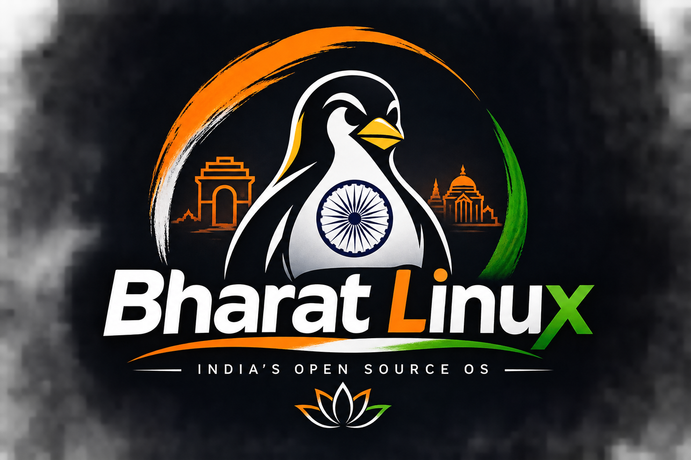
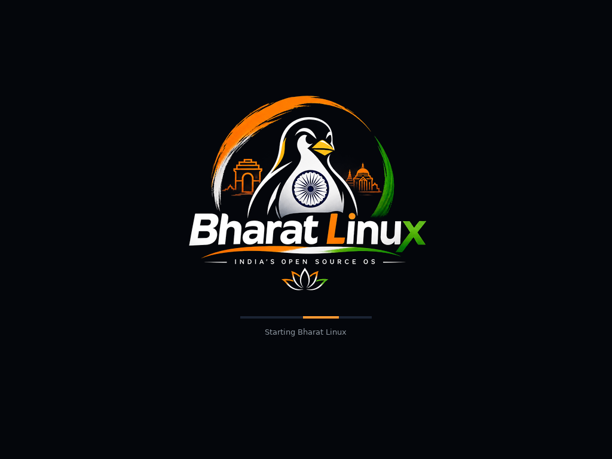
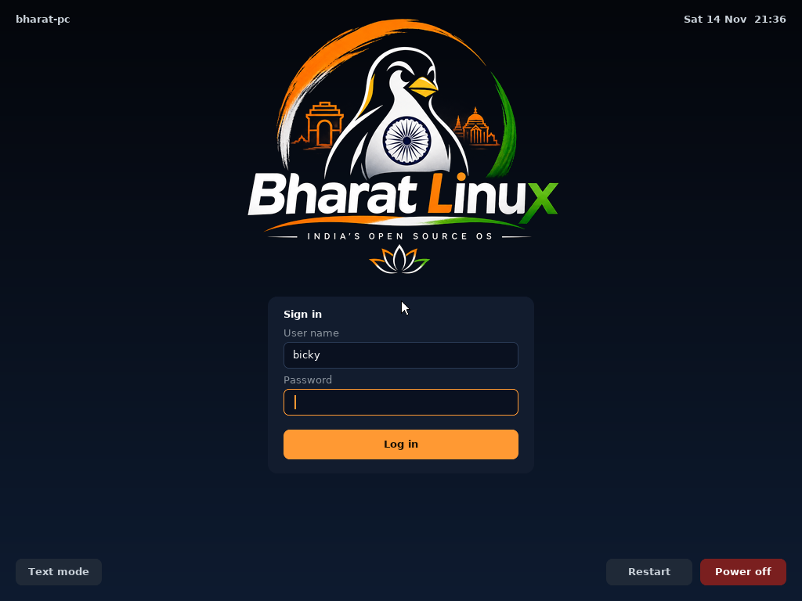
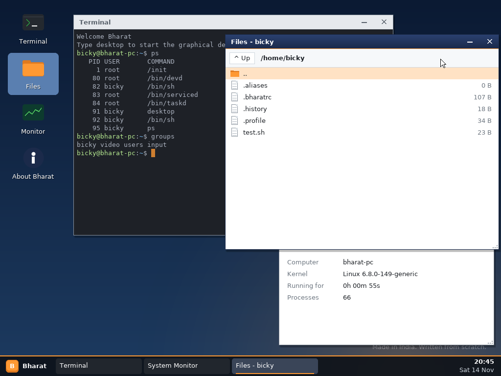

# Bharat Linux



A small operating system project from India. The goal is an indigenous OS:
every part that the user touches is written here, from scratch, in C.

## What it is today

| Part | Where it comes from |
|------|---------------------|
| Kernel | The Linux kernel of your PC (`/boot/vmlinuz-<version>`) |
| `init` (first program, PID 1) | Written here: `src/init.c` |
| Boot screen and graphical login (`greeter`) | Written here: `src/greeter/` |
| Text login | Written here: `src/login.c` |
| Shell (`bharat-shell`) | Written here: `src/sh.c` |
| 74 everyday commands (`ls`, `cp`, `grep`, `find`, ...) in one program | Written here: `src/coreutils/` |
| Other commands (`ps`, `kill`, `sudo`, `useradd`, ...) | Written here: `src/*.c` |
| Graphical desktop (`desktop`) | Written here: `src/desktop/` |
| `modprobe`, device helper `devd` | Written here: `src/modprobe.c`, `src/devd.c` |
| Network helpers (`ip`, `udhcpc`) | BusyBox (ready-made, to be replaced) |

So right now this is **our own userland on top of the Linux kernel**.
It boots like a normal Linux system: an animated boot screen with the
logo, then a graphical login screen, then the desktop.

| Boot | Login | Desktop |
|------|-------|---------|
|  |  |  |

## Build and run

You need: `gcc`, `make`, `musl-tools`, `e2fsprogs`, `cpio`, `fakeroot`,
`git`, `curl` and `qemu-system-x86`. On Ubuntu:

```sh
sudo apt install build-essential musl-tools e2fsprogs cpio fakeroot git curl qemu-system-x86
```

The first `make` also downloads and builds the disk formatting tools
(about a minute, only once; see [THIRD-PARTY.md](THIRD-PARTY.md)).

`musl-tools` is optional but recommended: with it, all programs together
take about 3 MB instead of 46 MB (see "Light on resources" below).

Then:

```sh
make            # 1. compile every program in src/ into rootfs/
./rebuild.sh    # 2. build the disk image images/bharat.img
./run.sh        # 3. boot it in QEMU
```

The boot screen appears, then the login screen: type the password and
press Enter. Shut down from the start menu: **Power off**.

**First start:** the "Create your account" screen appears. Choose a user
name and a password (8 or more characters). This account is an
administrator. No password ships inside Bharat Linux.

These two passwords are public defaults. Change them with `passwd` before
using the system for anything real.

Other ways to run:

```sh
./run.sh text              # boot inside the terminal (leave: Ctrl-A then X)
make initramfs             # quick test image, no disk needed
./run.sh initramfs
./run.sh disks=1           # with an extra empty 8 GB disk (try: sudo bharat-disk add)
./run.sh usb               # with a USB stick plugged in (images/usb.img)
./run.sh ram=1024          # with more memory (MB)
```

### Live USB stick, ISO, and installing

Build a live image that starts from a USB stick or DVD, on old (BIOS)
and new (UEFI) PCs:

```sh
sudo apt install grub-pc-bin grub-efi-amd64-bin grub-common xorriso mtools \
                 systemd-boot-efi systemd-ukify openssl ovmf
make iso                   # builds images/bharat-live.iso (about 45 MB)
./run.sh iso               # a virtual UEFI PC with an empty 20 GB disk
```

The welcome screen offers two choices:

- **Try Bharat Linux**: the whole system runs in memory. Nothing on the
  computer is changed, and nothing is kept when you switch off. (Text
  mode user: `live`, password `live`.)
- **Install Bharat Linux**: three steps (which disk, your account,
  check) and a progress bar. Everything is shown in plain words before
  anything is erased. In text mode: `sudo bharat-install`.

After installing, close QEMU and start the installed system:

```sh
./run.sh installed
```

On a real USB stick (this ERASES the stick; check the name with `lsblk`!):

```sh
sudo dd if=images/bharat-live.iso of=/dev/sdX bs=4M status=progress conv=fsync
```

How the installed system starts: the disk gets an EFI part (256 MB) and
the system part (ext4). The EFI part holds one file, `BOOTX64.EFI`: the
kernel, a tiny start-up program (`bootstrap`: loads the disk drivers,
checks the disk, opens it) and the command line, in one file. Every UEFI
PC starts it by itself; the installer also adds "Bharat Linux" to the
PC's boot menu. No boot loader to configure or break. The installed
system needs a UEFI PC (all PCs since about 2012) with Secure Boot
switched off (for now).

### Drivers

The mouse and network drivers must match the kernel that boots, so they
are copied from your PC (only the few in `tools/modules.list`, about 1 MB).
`./rebuild.sh` does this by itself the first time. After a kernel update
on your PC, copy them again:

```sh
make modules
./rebuild.sh
```

Networking: inside Bharat-linux, as root: `service modules`, then
`service network`.

## How it starts

1. The kernel starts `init` (`src/init.c`).
2. `init` starts `devd` (drivers, device permissions) and the services.
3. `init` starts `greeter` (`src/greeter/`), which shows the animated boot
   screen (the logo fades in, three dots pulse) while the drivers load.
4. On the very first start, a "Create your account" screen instead
   (see "Users and security"). After that, the logo glides up into the
   graphical login screen. It has **Restart**,
   **Power off** and **Text mode** (the old text login; type `exit` there
   to come back).
5. After the password, `greeter` starts the desktop as that user.
   **Log out** (start menu) brings the login screen back.

Without a graphics screen (`./run.sh text`), `init` starts the text login
instead.

Automatic login (no password at start-up) is off. To turn it on, remove
the `#` in front of `autologin=bicky` in `rootfs/etc/greeter.conf` and run
`./rebuild.sh`. Anyone who can use the computer then gets into `bicky`'s
account.

The logo pictures in `rootfs/usr/share/bharat/` are made from
`docs/logo.png` by `tools/make-logo.py`.

## Bharat Desktop

Our own graphical desktop, written from scratch in C (`src/desktop/`).
It draws straight into the Linux framebuffer (`/dev/fb0`) and reads the
keyboard and mouse straight from the kernel (`/dev/input/event*`).
There is no X11, no Wayland and no toolkit underneath.

- Windows you can drag, resize (bottom-right corner), minimise and close
- Taskbar with a start menu, window buttons and a clock (India time)
- **Terminal**: a real shell inside a window (colours, Ctrl-C, resizing)
- **Files**: browse folders, open text files in the **Text Viewer**
- **System Monitor**: live processor graph, memory, uptime, processes
- Smooth (anti-aliased) text from the DejaVu fonts

| Keys | Action |
|------|--------|
| Ctrl+Alt+T | New terminal |
| Alt+Tab | Switch window |
| Alt+F4 | Close the window |
| Ctrl+Alt+Backspace | Log out (or, if started from a shell, back to it) |

How it fits together:

1. `run.sh` boots with `vga=0x318`, so the kernel gets a 1024x768
   graphics screen and offers it as `/dev/fb0`.
2. `devd` (started by `init`) loads the mouse drivers listed in
   `/etc/modules` and gives the devices in `/etc/devices` to the `video`
   and `input` groups.
3. Every user is in those groups (`/etc/group`), so the desktop
   runs as a normal user, not as root.

The fonts are turned into C tables by `tools/make-fonts.py`
(licence: `fonts/LICENSE-DejaVu.txt`).

## Light on resources

Bharat-linux is built to run on small machines and to leave your PC alone.

| | |
|---|---|
| Whole running system with the desktop | about 40 MB of memory |
| QEMU memory | 256 MB (`run.sh`) |
| All programs in `/bin` | about 3 MB (built with musl), plus BusyBox 2 MB |
| Disk image | 256 MB file, about 25 MB actually used |
| Desktop when nothing happens | 0% processor: it wakes up once a minute (clock) |

How:

- **Small programs**: `make` uses musl, a small C library, when it is
  installed, and builds with `-Os` and `--gc-sections` (leave out unused
  code). `make LIBC=glibc` builds with the normal C library instead.
- **Redraw only what changed**: the desktop remembers which boxes of the
  screen changed (the mouse pointer, one line of the terminal) and redraws
  only those, instead of the whole 1024x768 screen.
- **Sleep instead of checking**: the desktop, `devd` and `serviced` sleep
  until the kernel wakes them (a key press, a new device, a stopped
  service). Nothing checks "every few seconds" any more.

## Commands

Type `help` for the full list with a short explanation of each.
Every command also answers `--help`. They work like on Ubuntu, with the
options people use most:

| Kind | Commands |
|------|----------|
| Files and folders | `ls -la`, `cp -r`, `mv`, `rm -r`, `mkdir -p`, `rmdir`, `touch`, `ln -s`, `stat`, `file`, `find . -name '*.c'`, `du -sh`, `df -h`, `chmod u+x`, `chown`, `chgrp`, `basename`, `dirname`, `realpath`, `readlink` |
| Text | `cat -n`, `head`, `tail -f`, `wc -l`, `grep -rni`, `sort -nru`, `uniq -c`, `cut -d: -f1`, `tr a-z A-Z`, `tee`, `diff`, `cmp`, `less`, `more`, `nl`, `tac`, `rev`, `echo -e`, `printf`, `seq`, `xargs`, `yes` |
| System | `pwd`, `uname -a`, `hostname`, `uptime`, `date +%H:%M`, `cal`, `free -h`, `nproc`, `lscpu`, `lsmod`, `dmesg`, `sync`, `env`, `printenv`, `which`, `tty`, `clear`, `sleep` |
| Disks | `lsblk -f`, `blkid`, `mount -a`, `umount`, `eject`, `mkswap`, `swapon`, `swapoff`, `bdisk`, `bharat-disk`, `mkfs.ext4`, `mkfs.fat`, `fsck.ext4`, `fsck.fat` |
| Processes | `ps`, `kill`, `killall`, `pkill`, `pidof`, `pgrep`, `top`, `jobs` |
| Users | `sudo`, `passwd`, `useradd`, `userdel`, `usermod`, `id`, `groups`, `whoami` |
| Scripts | `test` / `[ ]`, `true`, `false` |

All 80 commands in `src/coreutils/` are one program of about 200 KB:
`/bin/ls`, `/bin/cp` ... are links to `/bin/coreutils`, which looks at the
name it was started with.

## Disks and USB sticks

Like on other Linux systems, you can add disks and use USB sticks:

- **USB sticks open by themselves.** Plug one in while you are logged in
  to the desktop: it appears in `/media/YOUR-NAME/STICK-NAME` and a Files
  window shows it. Remove it safely with the **Eject** button in **Disks**,
  or `eject /media/ravi/PENDRIVE`. Nothing on a stick can run as a
  program or gain extra rights (it is opened with `noexec,nosuid,nodev`),
  and only the person at the desktop can see it.
- **Adding a disk is guided:** open **Disks** and press **Add a disk...**,
  or type `sudo bharat-disk add`. Choose the disk, give it a name, choose
  Linux (ext4) or "also Windows/phones" (FAT32). Everything is shown in
  plain words before anything is erased. The disk is then ready at
  `/data/NAME` at every start.
- **Full control** for those who want it:

| Command | What it does |
|---------|--------------|
| `lsblk`, `lsblk -f` | disks, parts, file systems, where they are open |
| `blkid` | label, UUID and type of every part |
| `bdisk show sdb` | the parts of a disk and its free space |
| `sudo bdisk new sdb` / `add sdb 20G` / `delete sdb 2` / `undo sdb` | GPT partitioning, with an undo |
| `sudo mkfs.ext4 -L NAME /dev/sdb1`, `sudo mkfs.fat -F 32 /dev/sdb1` | format a part |
| `sudo fsck.ext4 /dev/sdb1`, `sudo fsck.fat /dev/sdb1` | check and repair |
| `sudo mount /dev/sdb1 /mnt`, `mount UUID=... /mnt`, `sudo mount -a` | open parts |
| `/etc/fstab` | disks opened at every start (`nofail` = never blocks the start) |
| `mkswap`, `swapon -s`, `swapoff`, `sudo bharat-disk swapfile 1G` | swap space |

At start-up, the disks in `/etc/fstab` are checked (`e2fsck -p`) and
opened. A missing or damaged disk never stops the computer from
starting: it is skipped or opened read-only, with a message.

**zram:** part of the memory is used as compressed swap (50 % by
default, set in `/etc/zram`; 0 turns it off). Old pages are squeezed to a
third of their size, so a 2 GB computer behaves as if it had more, with
no wear on a USB stick or SSD.

`bdisk` refuses to change a disk that is in use (including the one the
system runs from), and keeps a copy of the previous table in
`/var/lib/bharat/disk-backup/`, so `bdisk undo` can bring it back.

## Shell quick guide

```sh
ls *.c ~/docs                      # wildcards and ~ (home folder)
echo "hello world" > file.txt      # write to a file (>> adds to the end)
cat nothere 2>/dev/null            # hide error messages (2>&1, &> too)
make && ./run || echo failed       # && after success, || after failure
cd /tmp ; ls                       # ; runs one after the other
cat file.txt | grep hello | wc -l  # pipes
sleep 30 &                         # background job (see: jobs, ps, kill)
NAME=Bharat                        # variable
echo Hello $NAME, last status $?
alias ll ls -l                     # saved in ~/.aliases
run script.sh                      # run a script file
```

Start-up commands go in `~/.bharatrc`.

## Folder layout

```
src/        all C source code (src/desktop/ = the graphical desktop)
rootfs/     the files that end up on the disk (/etc, /home, /bin, ...)
images/     built disk images (not stored in git)
build/      build helpers (build/musl-include is made by make)
Makefile    build rules
rebuild.sh  builds images/bharat.img
run.sh      starts QEMU
tools/      helper scripts (file owners, drivers, fonts)
docs/       pictures for this README
```

Compiled programs and kernel modules are **not** stored in git any more.
`make` creates them again on your PC.

## Users and security

Bharat Linux handles accounts the way Ubuntu and Fedora do:

- **No built-in passwords.** On the first start, you create your own
  account (graphical screen, or questions on the text console).
- **Root is locked.** Nobody can log in as `root`. Administrators use
  `sudo` with **their own** password; only members of the `wheel` group
  may. After a correct password, `sudo` does not ask again for 5 minutes
  (`sudo -k` forgets it at once). To allow root logins anyway:
  `sudo passwd root`.
- **Passwords** are stored only as salted SHA-512 hashes in
  `/etc/shadow` (root-only), need at least 8 characters, and are never
  shown while typing. Wrong passwords cost a 2-second pause.
- **Every login, failed login, sudo use and account change** is written
  to `/var/log/auth.log` (root-only): `sudo cat /var/log/auth.log`.
- `login` and the login screen switch to the user's real uid and groups,
  so the Linux kernel enforces every file permission.
- **Clean shutdown:** `poweroff` and `reboot` ask every program to stop,
  wait up to 5 seconds, save everything to disk and make it read-only.

| Command | What it does |
|---------|--------------|
| `sudo useradd meera` | new user (`-a`: administrator) |
| `sudo passwd meera` | set or change a password |
| `passwd` | change your own password |
| `sudo passwd -l meera` / `-u` | lock / unlock an account |
| `passwd -S` | is my account usable? |
| `sudo usermod -aG wheel meera` | make an administrator (`-rG` removes) |
| `sudo userdel -r meera` | delete a user and the home folder |

New users get a copy of `/etc/skel` as their home folder. The last
administrator cannot be deleted.

## Known limits (honest list)

- `sudo` rules are all-or-nothing: an administrator may run anything.
- No disk encryption and no firewall yet.
- `nano` can only write a new file line by line; it cannot edit.
- `ping` is a TCP connection test, not real ICMP.
- `rootfs/advanced.sh` and `rootfs/check.sh` use syntax (`function`, `loop`,
  `if EXIST ... endif`) that the shell does not understand yet.
- The desktop has no copy and paste, no scroll-back in the Terminal, and
  no Indian-language text yet.
- The desktop needs a graphics screen: it does not work with `./run.sh text`.
- The installer erases the whole chosen disk: installing next to Windows
  (dual boot) is not offered yet. Installed systems need UEFI with Secure
  Boot off. The ISO uses the kernel of the PC that built it.

## Roadmap to an indigenous OS

1. **Real users** (done): `login` switches to the real uid/gid and
   passwords are hashed, so the kernel enforces permissions.
2. **Own tools instead of BusyBox**: `modprobe` is done; `ip` and a DHCP
   client are left.
3. **Better shell**: line editing, arrow-key history, `if/else`, functions.
4. **Own kernel configuration**: build the Linux kernel from source with only
   the drivers that are needed (`kernel/` folder), instead of borrowing the
   PC's kernel.
5. **Graphical desktop** (first version done): next are a text editor,
   copy and paste, settings, and apps launched as separate programs.
6. **Disks** (done): partitioning, formatting, fstab, USB sticks, zram.
7. **Boot on real hardware** (done): live ISO for USB sticks and DVDs
   (BIOS and UEFI), graphical and text installer, UEFI start-up.
8. **Indian-language support**: Devanagari and other scripts in the desktop.
9. **Long term**: an own kernel is a multi-year project; steps 1 to 8 give a
   system that is useful and understood line by line before that.
